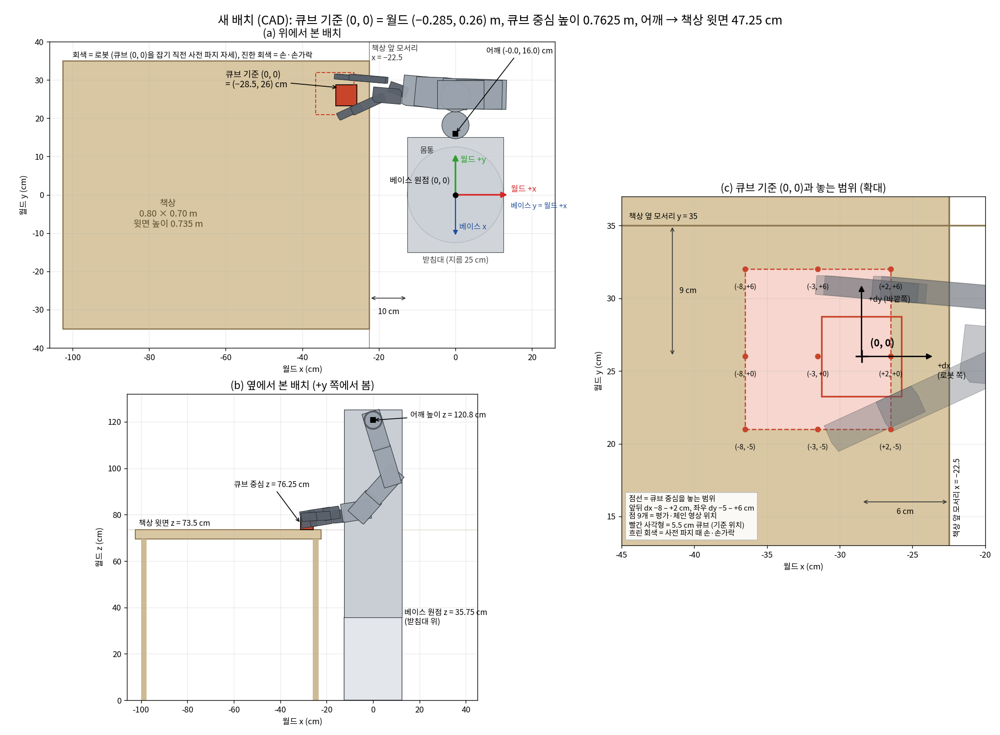

# MuJoCo sim-to-sim 검증 지시 (2026-11-10 최종 사양: 정책 grasp_lift_25300 · 관절 관측 = 보낸 목표각 · 실물 모터 토크 한계 · 손가락·큐브 마찰 2.0 · URDF_1109 · 팔 모터 서보 모드 · 어깨축 → 책상 47.25 cm · 50 mm 큐브)

대상: team-jax/sim-to-real 저장소에서 MuJoCo 검증을 맡은 에이전트 또는 팀원

## 0. 먼저 읽을 것: 최종 사양 (README 맨 위 상자)

1. **로봇 모델: URDF_1109.** deploy의 `robot_v3/urdf/JAXV3_Assembly.urdf`로 MuJoCo 모델을 만듭니다. 원본 `robot_v3/urdf/JAXV3_Assembly_1109_original.urdf`는 참고용입니다(같이 든 메시가 1108 파일이라 원본으로 열면 Wrist_Pitch 시각 메시가 180° 돌아 보입니다).
   - 과제용 URDF는 원본 1109와 순운동학이 같고, **1번 어깨 롤(`shoulder_roll_to_shoulder_yaw`)만 부호가 반대**입니다(README 5.1). 원본으로 모델을 만들었다면 1번 관절값의 부호를 뒤집어 넣고 받습니다.
   - URDF_1108에서는 4번(`under_arm_to_wrist_pitch`)도 반대였습니다. 1109에서는 문서와 같습니다.
   - 그 밖의 차이(링크 이름의 `_1` 제거, 충돌 형상 `*_fromV2_collision.stl`, 받침대 충돌 제거)는 README 5.1에 있습니다.
   - 관절 한계는 어깨 롤 0 – 50°, 팔꿈치 ±100°입니다. 질량·관성은 URDF 값을 그대로 씁니다. 바꾸려면 근거와 함께 "사양 빈칸"으로 보고합니다.
2. **배치: 어깨 피치축 → 책상 윗면 47.25 cm.** 책상 윗면 0.735 m, 어깨축 1.2075 m입니다(4절).
   - URDF는 `base_link`(바닥)에서 어깨축까지 1.2125 m라서, 어깨축을 1.2075 m에 맞추려면 `base_link`를 z −0.005에 둡니다. 높이는 모두 어깨축 기준으로 맞춥니다.
   - 조회표는 섞지 않습니다(**e = 0**). 관측 30번의 dz는 **−0.0575**입니다(README 7.1, 8.1).
3. **팔 모터는 서보 모드입니다.** 실물 AK45는 명령한 관절각에 처짐 없이 서는 위치 서보로 씁니다.
   - **명령값은 모두 처짐 보정이 없는 기하 자세**입니다: 들어올리기 P_geo + S(README 7.1), 밀어 넣기와 정책 단계에 중력 항 없음(7.3, 7.4), ㄴ자 q_L = (0, 0, 7.2, 90.0, 0, −2.6, 0)°(7.7).
   - MuJoCo 액추에이터도 명령 자세에 처짐 없이 서야 합니다. 예를 들어 위치 액추에이터의 kp를 크게 두고 중력을 보상합니다(MuJoCo의 중력 보상 기능이나 `qfrc_applied`에 중력 토크를 넣는 방식). 어떤 방식을 썼는지와 kp·kd 값을 보고합니다.
   - Isaac에서는 팔 PD를 kp 500, kd 40으로 두고, 목표에 그 자세의 중력 토크 / kp를 더해 같은 상태를 흉내 냈습니다.
   - 손가락(**MG90S**)은 README 5.3의 PD(kp 40, kd 2, armature 2e-4)를 그대로 씁니다. 손가락 힘은 닫기 힘 제어(README 7.5)가 맞춥니다.
4. **정책:** `grasp_lift_25300`이고 **입력이 45개입니다**(README 8.1).
   - **관절 입력(0–27번)은 실제 관절값이 아니라 보낸 목표각입니다(2026-11-10).** 0–13번은 그 스텝에 액추에이터로 보낸 관절 목표(정책 행동, 닫기 힘 제어, 들기 IK, ㄴ자 복귀를 모두 반영하고 한계로 자른 값), 14–27번은 (이번 목표 − 직전 스텝 목표) / dt × 0.2입니다. MuJoCo의 `qpos`·`qvel`을 넣으면 안 됩니다.
   - 넘길 때의 0.5 s 섞기(README 7.4)는 액추에이터로 가는 값에만 적용하고, 관측에는 섞기 전 목표를 넣습니다. 직전 목표는 넘기는 순간 지금 목표로 초기화합니다.
   - 들기 IK(README 7.6)의 손끝 위치와 손 방향, 넘기기(7.2)와 완료(7.8)의 팔 정지 조건도 실물처럼 **보낸 목표각**으로 계산합니다. 실제 관절값으로 계산한 결과도 따로 한 번 돌려 차이를 보고합니다.
   - 43개 뒤에 큐브 각도 sin 4ψ, cos 4ψ를 붙입니다. ψ = 큐브 세로축 각도 − θ(dx, dy)이고, θ는 `hand_theta_v65.pt`에서 찾습니다.
   - 큐브 각도는 들어올리기 전에 한 번 재서 에피소드 내내 그대로 넣습니다. MuJoCo에서는 시작할 때의 큐브 자세로 계산합니다.
   - 큐브 위치 관측(28–30번)은 관측 기준점 기준입니다. 관측 기준점은 **어깨축에서 −y로 0.16 m, 아래로 0.85 m인 점**, 곧 (0, 0, 0.3575)입니다. 관절 위치 관측(0–13번)은 V2 관절 한계(어깨 롤 0 – 45°, 팔꿈치 ±105°)로 정규화합니다.
5. **모터 토크 한계 (2026-11-10, README 5.3).** 액추에이터 힘 범위(`forcerange`)를 관절마다 실물 모터 값으로 둡니다.
   - Isaac 0–3(어깨 피치·롤·요, 팔꿈치): ±8 N·m (AK45-36 정격)
   - Isaac 4(`under_arm_to_wrist_pitch`): ±3.92 N·m, Isaac 5(`wrist_pitch_to_wrist_yaw`): ±1.96 N·m, Isaac 6(`wrist_yaw_to_hand_base`): ±0.92 N·m (MG996R)
   - Isaac 9(RotationBody)와 손가락 6관절: ±0.177 N·m (MG90S, 4.8 V)
   - 팔 서보를 큰 kp로 흉내 내면 작은 오차에도 이 한계에 닿습니다. 한계에 닿은 시간 비율을 관절마다 기록해 보고합니다.
6. **마찰 (2026-11-10, README 10절).** 손가락 6개 링크(Finger_1_1, 1_2, 2_1, 2_2, 3_1, 3_2)와 큐브는 **정지 2.0 / 동 1.95**, 나머지 로봇 링크는 0.4 / 0.35, 책상은 1.2 / 1.0입니다.
   - Isaac은 두 물체 값의 **평균**으로 결합합니다. MuJoCo 기본(두 geom 중 큰 값)과 다르므로, 접촉 쌍마다 미끄럼 마찰을 직접 정합니다(`<pair>` 또는 priority): 손가락–큐브 2.0, 큐브–책상 1.6, 손가락–책상 1.6, 손바닥·RotationBody–큐브 1.2, 나머지 로봇–책상 0.8.
   - 실물은 손가락 패드나 큐브에 고무 등을 붙여 이 마찰을 맞출 예정입니다. 손가락–큐브 1.5로도 한 번 돌려 봅니다.
7. **조이는 세기 식 (README 7.5):** S_f = 1.2 + 0.8·a7 N, S_t = 1.2 + 0.8·a9 N(0.3 N 이상)입니다. 이전 정책은 5 + 4·a였습니다.
8. **ㄴ자 복귀 중 쥐기 (README 7.7):** 행동 7을 +1로 고정하고(필터 거침), 8–10번은 복귀 시작 때 값으로 고정합니다.
- **바뀌지 않은 것:** 조회표 파일(`raise_grid_v65_*`, `pregrasp_grid_v65_*`), 놓는 범위(`reach_mask_v65.pt`), 손가락 닫기 힘 제어의 이득과 속도, 들기 IK 식, 압력 센서 모델, 행동 11개.
- **11-09 사양(정책 `grasp_lift_23025`)으로 이미 구현했다면** 위 4 – 8번을 바꿉니다. 23025는 실제 관절값 관측, 토크 한계 없음, 마찰 0.4로 학습했습니다(README 16.7).
- **11-08 사양(URDF_1108, 스프링 팔 가정, 47.75 cm)으로 이미 구현했다면** 위 1 – 3번을 바꿉니다. 그 사양의 값은 README 16.6에 있습니다.
- **이 사양용 파일**
  - 쥐고 드는 정책 `grasp_lift_25300.pt` / `.onnx` / `_meta.json`
  - 조회표 `raise_grid_v65_basec.pt`, `pregrasp_grid_v65_basec.pt`, 손 방향 표 `hand_theta_v65.pt`. `_m3c` / `_p3c`는 책상 높이를 바꿔 볼 때만 씁니다
  - 놓는 범위 표 `reach_mask_v65.pt`
  - 로봇 모델 `robot_v3/` (URDF와 메시)
  - 들어올리기 보정 정책은 없습니다.

## 1. 목적

JAX 한 팔 로봇 정책을 Isaac에서 MuJoCo로 옮겨 검증합니다(sim-to-sim). 실물로 가기 전에, 배포 사양만으로 정책이 다른 시뮬레이터에서도 동작하는지 봅니다.

## 2. 원칙

- 구현 근거는 JaxIsaacLab(브랜치 `jax-one-arm-grasp-sim2real`)의 `artifacts/deploy_2026-11-05/` 폴더뿐입니다. 폴더에는 `README.md`, 정책 파일, 조회표, 로봇 모델(`robot_v3/`), 이 문서가 있습니다.
  - 실물 제어 코드도 이것만 보고 만듭니다.
- Isaac 학습 코드나 로그 값을 보고 결과를 맞추지 않습니다. README와 `TROUBLESHOOTING.md`에 있는 Isaac 결과도 맞추는 목표로 쓰지 않습니다.
- 사양에 없거나 모호한 것은 추측해서 채우지 않고 "사양 빈칸"으로 따로 보고합니다.
- 물리 설정(접촉, 마찰 등)은 실물 근거가 있을 때만 바꿉니다. 바꾸면 바꾸기 전과 후 결과를 모두 보고합니다.
- 결과는 실패 이유까지 그대로 적습니다. 프로그램이 끝났다고 성공으로 보지 않습니다.

## 3. 할 일

1. 로봇 모델을 `robot_v3/urdf/JAXV3_Assembly.urdf`로 만듭니다.
   - 관절 축, 한계, 질량, 관성, 충돌 형상은 URDF 그대로 씁니다. 받침대(`base_link`)와 꼭대기 가로대(`Holder`)는 고정입니다.
   - 팔 8관절은 0절 3번의 서보(명령 자세에 처짐 없이 섬)로, 손가락 6관절은 README 5.3의 PD로 둡니다. 속도 한계 1 rad/s, 관절 마찰 0. 힘 범위는 0절 5번의 토크 한계입니다.
   - 팔 서보가 명령 자세에 처짐 없이 서는지 먼저 확인합니다. 사전 파지 자세와 ㄴ자 자세를 명령하고 관절각 오차를 기록합니다.
2. 큐브를 사양대로 둡니다: 한 변 **5.0 cm**, 무게 40 g. 30 g과 50 g도 한 번씩 돌려 봅니다.
3. 배치는 4절의 최종 배치 하나만 씁니다.
   - 높이는 바닥이 아니라 **로봇 기준**으로 맞아야 합니다. 어깨 피치축 → 책상 윗면이 47.25 cm인지 순운동학으로 확인합니다.
4. 관측 45개를 README 8.1대로 만듭니다.
   - 큐브 각도 입력(43–44번)은 시작할 때 큐브 자세로 한 번 계산해 고정합니다. 실물 카메라 오차를 흉내 내려면 ±3° 균일 오차를 더해 한 번 더 돌려 봅니다.
5. 큐브 위치와 각도는 무작위로 20곳 이상 뽑고, 뽑은 값을 기록합니다.
   - 위치는 `reach_mask_v65.pt`의 범위 안에서 뽑습니다(README 10절). (0, 0), (+2, ±28), (−8, ±18), (−14, −8), (−14, +6) cm는 따로 한 번씩 꼭 넣습니다.
   - 각도는 세로축 −45 – +45°에서 뽑습니다. 0°, ±20°, ±35°, ±45°는 따로 한 번씩 꼭 넣습니다.
6. 위치마다 다음을 기록해 보고합니다.
   - 단계 시각: RAISE, SETTLE, INSERT, GRASP_LIFT, RETURN, DONE
   - 쥐기 시작 순간(INSERT 끝)의 팔 관절 8개 (°)와 명령값과의 차이
   - 손가락별 힘(첫 마디 + 끝마디)이 처음 0.3 N을 넘은 시각, 세 손가락이 모두 닿은 시각
   - 최대 상승 높이, 들어올리기 중 손–큐브 최대 접촉력, 손가락–책상 최대 접촉력, 큐브 이동량(쥐기 전 / 후 따로), 큐브 각도 변화(쥐는 동안 / 들고 난 뒤 따로)
   - DONE 여부와 실패 이유, DONE 순간의 `pad_N`, 관절각, 손 높이(어깨축 기준), 큐브 기울기
7. 위치마다 `trace.npz`와 `summary.json`을 남깁니다.

Isaac 결과와의 비교는 따로 합니다.

## 4. 최종 배치 (목표, 실물과 같음) 정확한 수치

좌표는 월드 좌표(바닥 z = 0), 단위는 m입니다. 높이는 어깨 피치축을 기준으로 정했습니다.

| 항목 | 값 |
|---|---|
| 어깨 피치축 (기준) | (0, 0.16, **1.2075**) |
| 로봇 `base_link` 원점 | (0, 0.01, **−0.005**), z축 −90° 회전 (quat wxyz 0.7071, 0, 0, −0.7071). URDF에서 어깨축은 `base_link`의 (−0.15, 0, 1.2125)라서 이 위치에 두면 어깨축이 위 값에 옵니다 |
| 관측 기준점 | (0, 0, **0.3575**). 어깨축에서 −y로 0.16, 아래로 0.85인 점(README 4절). `base_link` 좌표계로는 (0.01, 0, 0.3625) |
| 책상 | 상자 0.80 × **1.2** × 0.04, 중심 (−0.625, 0, 0.715) |
| 책상 윗면 / 앞 모서리 / 옆 모서리 | z **0.735** / x −0.225 / y ±0.60 |
| 큐브 | 한 변 **0.050**, 0.040 kg (30–50 g 범위), 기준 중심 (−0.285, 0.26, **0.760**), 세로축 각도 −45 – +45° |
| 마찰 (정지 / 동) | 큐브와 손가락 6개 링크 **2.0 / 1.95**, 나머지 로봇 링크 0.4 / 0.35, 책상 1.2 / 1.0. 두 물체 값의 평균으로 결합(0절 6번의 쌍별 값) |
| 물리 / 제어 주기 | 120 Hz / 60 Hz |

**로봇 기준으로 본 치수** (실물도 이 값이어야 합니다)

| 항목 | 값 |
|---|---|
| 어깨 피치축 → 책상 윗면 | 아래로 **47.25 cm** |
| 관측 기준점 → 책상 윗면 | 위로 37.75 cm |
| 어깨 피치축 → 책상 앞 모서리 | 수평 22.5 cm |
| 큐브 중심 | 책상 앞 모서리에서 6 cm 안쪽. 어깨축에서 +y로 10 cm 바깥 |
| 학습 때 책상 높이 범위 | 어깨축 → 책상 46.25 – 48.25 cm(25300). 조회표로는 ±3 cm까지 계산 가능 |

**최종 배치에서 쓰는 값** (README에 반영됨)
- 어깨축 → 책상을 d라 하면 e = 0.4725 − d, 관측 30번의 dz = 0.415 − d입니다. 최종 배치는 **e = 0, dz = −0.0575**입니다.
  - 쥐고 드는 정책의 관측 30번에서는 dz 전체를 뺍니다.
  - e가 0이 아닐 때만 조회표의 −3 / +3 cm 표를 섞습니다.
- 팔 서보, 명령값은 기하 자세(0절 3번). 체인에 중력 항은 없습니다.
- 들어올리기 보정 정책은 쓰지 않습니다.
- 손가락 닫기: 이득 0.0012 rad/N, 최대 속도 0.15 rad/s.

## 5. 이전 사양

4절과 다른 값만 적었습니다.

| 항목 | 11-09 사양 23025 (README 16.7) | 11-08 사양 (README 16.6) | V2 로봇판 18125 (README 16.5) |
|---|---|---|---|
| 로봇 | URDF_1109 (지금과 같음) | URDF_1108. 1번·4번 부호 반대 | V2 `JAXV2_Assembly.urdf`(URDF_1006). deploy에는 없음 |
| 관절 관측 0–27 | 실제 관절 위치·속도 | 실제 관절 위치·속도 | 실제 관절 위치·속도 |
| 토크 한계 | 없음 (100 N·m) | 없음 | 없음 |
| 마찰 | 큐브·로봇 0.4 / 0.35 | 같음 | 같음 |
| 조이는 세기 | 5 + 4·a N, 복귀 중 행동 7–10 시작 때 값 | 같음 | 같음 |
| 어깨축 → 책상 | 47.25 cm (지금과 같음) | 47.75 cm (`base_link` z 0, 어깨축 1.2125) | 47.25 cm (베이스 원점 0.3575, 받침대 원기둥 반지름 0.125) |
| e / dz | 0 / −0.0575 | −0.005 / −0.0625 | 0 / −0.0575 |
| 관측 기준점 | (0, 0, 0.3575) | (0, 0, 0.3625) | V2 베이스 원점 (0, 0, 0.3575) |
| 팔 모터 | 서보 (지금과 같음) | 처지는 PD(kp 100, kd 8), 체인 중력 보상 τ_g/kp − s_fix | 처지는 PD, 고정 처짐 보정만 |
| ㄴ자 q_L | (0, 0, 7.2, 90.0, 0, −2.6, 0)° | (1.9, 0, 7.2, 92.1, 0, −1.9, −0.2)° | 같음 |
| 관측 | 45개 | 45개 | 43개 (큐브 각도 없음) |

- 그보다 앞의 배치(어깨 → 책상 41.5 cm, `grasp_lift_13075` + `pregrasp_grid_v49_*`)는 README 16.1에 있습니다.

## 6. 배치 그림 (V2 배치, 참고)

- **이 그림은 V2 로봇, 어깨 → 책상 47.25 cm 배치입니다.** 어깨축 → 책상 거리는 최종 사양과 같고, V3는 받침대 모양이 다릅니다(바닥판 + 기둥 + 꼭대기 가로대).
- 로봇은 URDF 충돌 형상을 순운동학으로 계산해 그렸습니다.
- 그린 자세는 기준 큐브 (0, 0)을 잡기 직전의 사전 파지 자세입니다(v53 조회표).
- (0, 0)은 큐브 중심의 기준 위치, 월드 (−0.285, 0.26) m입니다. dx가 +면 로봇 쪽(+x), dy가 +면 책상 옆 모서리 쪽(+y)입니다.
- 정책 관측의 베이스 좌표는 월드와 축이 다릅니다. 베이스 x = 월드 −y, 베이스 y = 월드 +x입니다.
